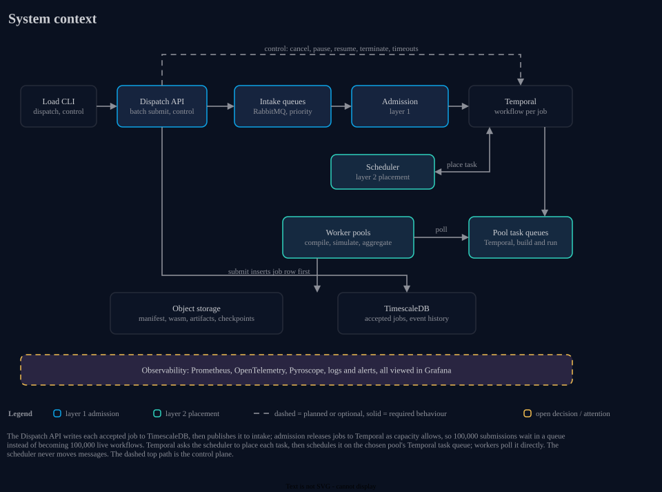

# wasm-dag-forge

A proof of concept for durable distributed job execution: batch jobs built from templates
(compile, simulate, aggregate), run as WASM on a fixed-size local Kubernetes cluster.

## Getting started

See [docs/dev-setup.md](docs/dev-setup.md).
Entering the dev shell with `nix develop` also installs the git hooks, described under [Git hooks](docs/dev-setup.md#git-hooks).
