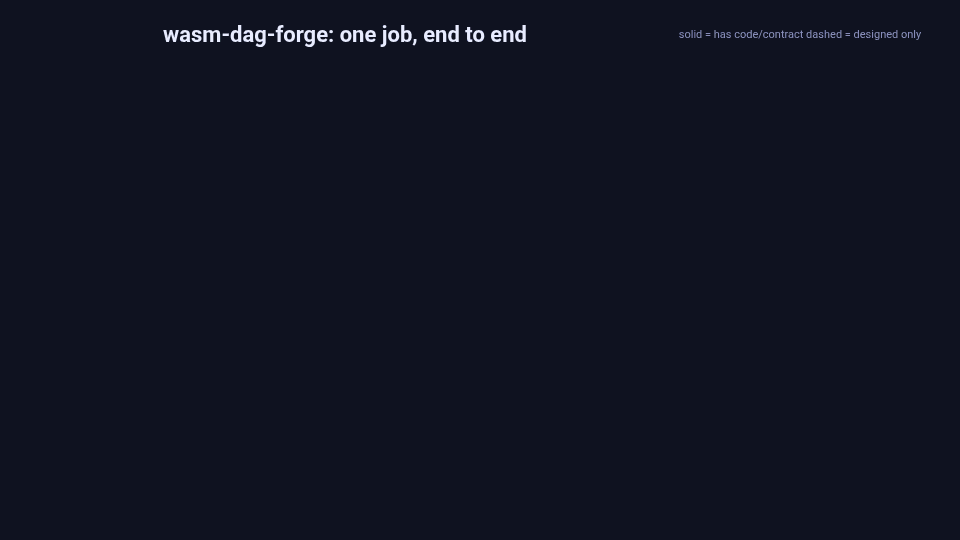

# wasm-dag-forge

A proof of concept for durable distributed job execution: batch jobs built from templates
(compile, simulate, aggregate), run as WASM on a fixed-size local Kubernetes cluster.

## Worked example

One job from submission to completion.
Solid boxes have code or a contract today, dashed boxes are designed only.

Source and re-render steps: [docs/animations/](docs/animations/README.md).

## Getting started

See [docs/dev-setup.md](docs/dev-setup.md).
