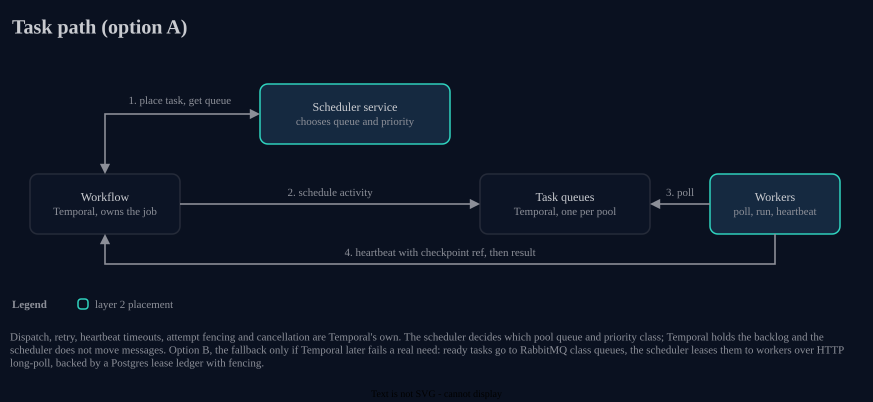

# Diagrams

Architecture diagrams live in `docs/architecture/` as draw.io files.
Every `NN-name.drawio` has a same-named `NN-name.drawio.svg` beside it.
Keep both: commit them together.

## Which file is which

- `NN-name.drawio` is the editable source.
  `/drawio` and Claude edit this file.
- `NN-name.drawio.svg` is an export for embedding.
  It carries the diagram XML, so draw.io can still open and edit it.
  Never hand-edit it: regenerate it.

## Regenerating

After changing any `.drawio`, run:

```sh
scripts/export-diagrams.sh
```

This needs Docker.
It runs the headless draw.io export for every diagram:

```sh
docker run --rm -v <dir>:/data -w /data rlespinasse/drawio-desktop-headless \
  -x -f svg -e -b 10 --theme light -o /data/<name>.drawio.svg /data/<name>.drawio
```

- `-e` embeds the diagram XML in the SVG.
- `--theme light` pins the authored (dark) palette, so GitHub dark mode does not flip colours.
- Each SVG is roughly 400-600 KB because draw.io embeds fallback images of the text.

To check that no SVG is missing or older than its source (no Docker needed):

```sh
scripts/export-diagrams.sh --check
```

The check compares file mtimes, so run it in the checkout where you edited.
A fresh clone has arbitrary mtimes: regenerate rather than trust `--check` there.

## Embedding

In a markdown note in this repo, use a relative path:

```md

```

In a GitHub issue, use the full raw link to the file on `main` (the repo is public):

```md

```

## Mermaid

Mermaid in the text is fine for trivial flows.
Anything with layout or styling worth keeping belongs in draw.io.
