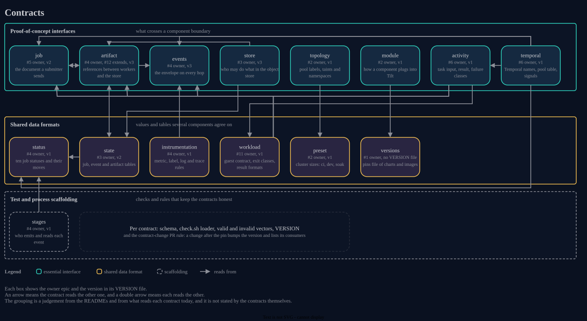

# Contracts

The `contracts/` directory holds the machine-checkable interfaces that components share: schemas, version files, error tables and test vectors.
A contract states what crosses a boundary, and the code that produces or consumes it lives in `packages/`, `scripts/` and `deploy/`.
There are many because each boundary between two components or epics has its own contract, and each contract ships its own schema, loader and vectors, so a drift between two sides fails a check instead of surfacing at integration.
Only some of them are needed to run the proof of concept, and the table and the diagram below separate those from the rest.

## Roles

- **PoC-essential interface**: a boundary that two components cross at run time, such as an event, a submitted job document or a reference to an object.
- **Shared data format**: a value, table or file shape that several components read and write, without being a call or message boundary.
- **Test and process scaffolding**: a check or a rule that keeps other contracts consistent, and that no running component reads.

The role column is a judgement made from the READMEs and from what reads each contract in the repository today.
The contracts do not state a role themselves.

## Map

The owner column names the epic that owns the contract, as each README states it.
Epic numbers link to the epic issues on GitHub.

| Contract | Owner epic | Produced by | Consumed by | Role |
| --- | --- | --- | --- | --- |
| [events](../contracts/events/README.md) | #4 | `packages/events` and `packages/keys` generate the data schemas and the key formulas | every epic | PoC-essential interface |
| [job](../contracts/job/README.md) | #5 | `packages/jobdoc` and its sibling packages generate the schemas, registry and limits schema | #24, #6, #8, #9, #3, #14, #15, #17 | PoC-essential interface |
| [artifact](../contracts/artifact/README.md) | #4, extended by #12 | the `wdf_artifactclient` models generate the failure, staging, retention and index schemas | #3, #4, #5, #6, #10, #11, #13, #15, #16, #17, #18, #24 | PoC-essential interface |
| [store](../contracts/store/README.md) | #3 | `packages/storecheck` generates the schema from its models | #12, #13, #16, #17, the object store module and the store contract script | PoC-essential interface |
| [topology](../contracts/topology/README.md) | #2 | a hand-written table, validated by its schema | placement and workers, observability, load and chaos, and the cluster work of #2 | PoC-essential interface |
| [module](../contracts/module/README.md) | #2 | each component ships its own `deploy/<component>/module.yaml` | the epics that ship an infrastructure component, and the Tilt skeleton | PoC-essential interface |
| [state](../contracts/state/README.md) | #3 | `packages/jobstate`, `packages/eventstore` and `packages/artifactindex` generate the row schemas | #24, #8, #6, #7, #12, #13, #16, #17 | Shared data format |
| [status](../contracts/status/README.md) | #4 | a hand-written table, validated by its schema | #3, #6, #8, #24 | Shared data format |
| [instrumentation](../contracts/instrumentation/README.md) | #4, then #13 | a hand-written metrics file, validated by its schema | #13 and every component that emits a metric, a log line or a span | Shared data format |
| [preset](../contracts/preset/README.md) | #2 | the files in `deploy/presets/`, validated by its schema | every epic through `just up`, plus `just doctor` and the cluster renderer | Shared data format |
| versions (a schema only, see [versions policy](versions-policy.md)) | #1 | `deploy/versions.yaml`, checked by `just versions --check` | #2, #3, #6, #7, #13 | Shared data format |
| [stages](../contracts/stages/README.md) | #4 | a hand-written table, validated by its schema and the event catalogue | #3, #6, #8, #9, #10, #24 | Test and process scaffolding |

Every contract directory also carries a `VERSION` file, a `check.sh` loader and valid and invalid vectors.
That common layer is scaffolding for all of them, and a change after the pin is a contract-change PR that bumps the version and lists the consumers.

## Essential to the proof of concept

### events

Every platform event is a CloudEvent 1.0 in structured mode, and the same bytes travel on every hop.
The contract pins the attribute profile, the data schema of each event type, the reader rule for versions and the key formulas for job, event and compile cache ids.
Details: [contracts/events/README.md](../contracts/events/README.md).

### job

A job is a JSON document of tasks keyed by id, of exactly three types: compile, simulate and aggregate.
The contract pins the document schema, the error table, the registries and the limits profiles that the validator applies.
Details: [contracts/job/README.md](../contracts/job/README.md).

### artifact

An artifact reference points to an object and holds no bytes.
The contract pins the reference shape, the four buckets and their key templates, and, since the artifacts epic, the failure taxonomy, staging, object caps, aggregate index format and reaper windows.
Details: [contracts/artifact/README.md](../contracts/artifact/README.md).

### store

The store contract says who may do what in the object store, which lifecycle rules each bucket carries and what each tested product is known not to do.
It reads the bucket names from the artifact layout and the windows from the state retention file, and it never retypes either.
Details: [contracts/store/README.md](../contracts/store/README.md).

### topology

The topology fixes how nodes are labelled and tainted into pools and which four namespaces exist.
Placement and workers read the pool label from it, and the pool roles come from the preset contract.
Details: [contracts/topology/README.md](../contracts/topology/README.md).

### module

A module is how one component plugs into the cluster, through a manifest and a Tilt file that it ships under `deploy/<component>/`.
The manifest ties the component to a group, a namespace, a pinned artifact and a readiness check, and nothing outside the `obs` group may depend on an `obs` resource.
Details: [contracts/module/README.md](../contracts/module/README.md).

## Shared data formats

### state

The state contract pins the three table families of the platform: the accepted job row, the event history and the artifact index.
It also pins the one writer of each kind of change and the retention windows of the safety net.
Temporal owns workflow lifecycle, and nothing here decides it.
Details: [contracts/state/README.md](../contracts/state/README.md).

### status

The job status is a stored value on the job row, and each status is set by one job lifecycle event type.
The table lists the ten stored statuses, the projection from event type to status and the allowed moves, and it keeps `pausing` and `cancelling` as views that are never stored.
Details: [contracts/status/README.md](../contracts/status/README.md).

### instrumentation

The instrumentation contract pins naming rules for metrics, bounded label rules, structured log fields and trace propagation.
Its metrics file holds only the metrics of the event contract until the observability epic takes the file over and extends it.
Details: [contracts/instrumentation/README.md](../contracts/instrumentation/README.md).

### preset

A preset fixes the numbers of one cluster size, and the same repository runs at `ci`, `dev` and `soak`.
The contract also pins the kubelet reservation rule and the table that maps host ports to node ports on `127.0.0.1` only.
Details: [contracts/preset/README.md](../contracts/preset/README.md).

### versions

`contracts/versions.schema.json` validates `deploy/versions.yaml`, where each entry is a version and a digest.
It has no README, because the pinning policy lives in [versions-policy.md](versions-policy.md).
The module contract resolves its artifact pins against this file.

## Test and process scaffolding

### stages

The stage table says, for each stage, which source it writes under, which attributes and data fields it reads and which event types it emits.
Its loader cross-checks the table against the event catalogue, so a type emitted by two stages without a condition, or by none, fails.
Only `packages/stages` reads the table in the repository today, and that is the reason for the scaffolding role.
Details: [contracts/stages/README.md](../contracts/stages/README.md).
